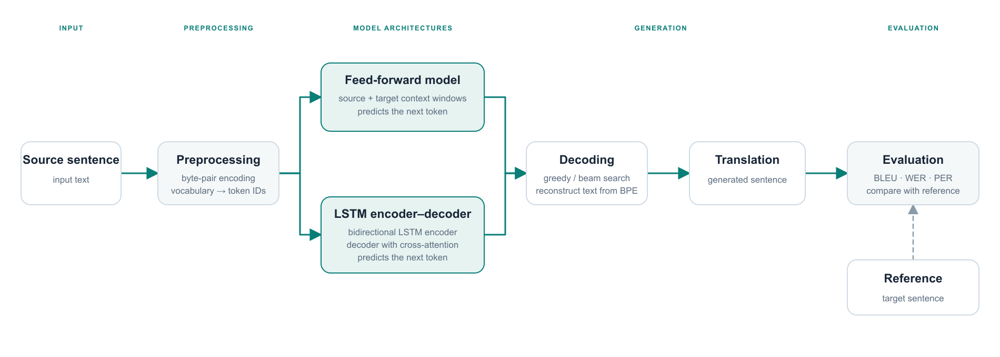

# Neural Machine Translation

A university team project exploring neural machine translation between German and English. We built and compared a feed-forward translation model and an LSTM-based encoder–decoder model with cross-attention.

The project covers the translation pipeline from preprocessing to evaluation:

- **Preprocessing:** byte-pair encoding, vocabulary construction, and batching.
- **Models:** a feed-forward baseline and a recurrent encoder–decoder with attention.
- **Decoding and evaluation:** greedy and beam search, with BLEU, word error rate, and position-independent error rate.
- **Experiments:** Multi30K data, model checkpoints, and plots comparing model and decoding configurations.

The models are implemented in **PyTorch**.
